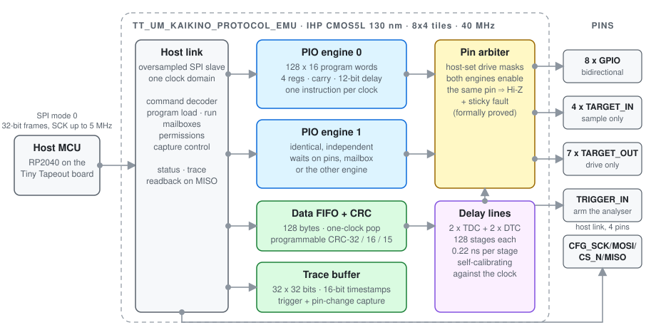

<h1 align="center">Programmable Protocol Emulator ASIC</h1>

<p align="center">
  <strong>Two PIO engines. Proven-safe shared pins. A hardware CRC. Edge timing to 0.2 ns.</strong><br>
  UART to Ethernet from 128 words of microcode, on 1.2 mm&sup2; of 130 nm silicon.
</p>

<p align="center">
  <a href="https://github.com/kaikino/core-asic/actions/workflows/test.yaml"></a>
  <a href="https://github.com/kaikino/core-asic/actions/workflows/gds.yaml"></a>
  <a href="https://github.com/kaikino/core-asic/actions/workflows/fpga.yaml"></a>
  <a href="https://github.com/kaikino/core-asic/actions/workflows/docs.yaml"></a>
  <br>
  
  
  
  
  
</p>

An open-source, reprogrammable GPIO protocol emulator for
[Tiny Tapeout](https://tinytapeout.com) on IHP's CMOS5L process, built for the
Jane Street protocol-emulator challenge.  Load a microprogram and the same
silicon speaks UART, SPI, I2C, JTAG, SWD, PS/2, CAN, low-speed USB or
10 Mbit/s Manchester Ethernet, on either side of the bus, with timing you can
work out with a pencil.  Then it tells you, to a fifth of a nanosecond, when
the other side answered.

<p align="center">
  <picture>
    <source media="(prefers-color-scheme: dark)" srcset="docs/img/architecture-dark.svg">
    
  </picture>
</p>

## Why it is not just another PIO

* **Time is data.**  Two tapped delay lines of 128 CMOS5L delay cells each
  let a program *measure* when an input edge arrived and *place* an output
  edge between clocks, at about 0.22 ns per stage from a 40 MHz clock,
  calibrated against the clock itself.  Read the setup margin on a live bus.
  Fire a fault-injection pulse at a chosen offset.  Timestamp edges a
  hundred times finer than the clock.
* **Pin sharing you can prove.**  Two engines and the host share the pins
  under host-set permission masks.  A pin both engines enable in the same
  clock goes high impedance and latches a sticky fault.  That rule, and ten
  more safety properties, are proved for all inputs by SymbiYosys.
* **A data path that keeps up with the wire.**  A 128-byte host FIFO popped
  in one clock and a programmable CRC unit (any reflected polynomial, bit- or
  byte-wise) stream a complete Ethernet frame with a hardware FCS at
  10 Mbit/s, or a CAN frame with CRC-15, or a USB packet with CRC-16.
* **One clock domain, start to finish.**  The SPI host link is oversampled
  by the core clock, so timing sign-off, the formal model and the gate-level
  simulation all see a single synchronous design.

## A protocol is twenty lines

Every instruction retires in exactly one clock; `delay` and `wait` stall
deterministically, so a program's timing is a property of the program.
This is the whole 8N1 transmitter (`examples/uart_tx.pio`):

```asm
.equ BIT 17                          ; 40 MHz / (BIT + 3) = 2 Mbaud
        movi  r1, 0x01
        out   r1, UIO, 0x01          ; idle high
        out   r1, UIO_OE, 0x01       ; drive GPIO0
loop:   wait  HIGH, MBOX_IN          ; a byte from the host
        in    r0, MBOX
        movi  r2, 8
        setp  UIO, 0, 0              ; start bit
        delay BIT
        nop
nbit:   shout_lsb r0, UIO, 0         ; one bit per instruction, LSB first
        delay BIT
        djnz  r2, nbit
        setp  UIO, 0, 1              ; stop bit
        delay BIT
        jmp   loop
```

And this is the heart of a fault-injection pulse whose edges land `r0`
delay stages after the clock (`examples/glitch_pulse.pio`, trimmed):

```asm
        in    r0, MBOX               ; fine offset in stages, ~0.22 ns each
        dtcw  r0, 0                  ; program DTC channel 0
loop:   wait  RISE, TRIG
        delay 2                      ; coarse offset: whole clocks
        setp  UO, 0, 1
        setp  UO, 0, 0               ; a 25 ns pulse, shifted by r0 stages
        done
        jmp   loop
```

## Load a program, speak a protocol

| Protocol | Program | Checked against |
|---|---|---|
| UART 8N1, both directions | `uart_tx.pio`, `uart_rx.pio` | independent Python monitor and source |
| SPI mode 0 master | `spi_master.pio` | Python slave, both directions |
| SPI slave: flash emulator (READ ID, READ from the FIFO) | `spi_flash.pio` | scripted Python master |
| I2C master with clock stretching | `i2c_master.pio` | ACKing Python slave |
| I2C slave: EEPROM emulator from the FIFO | `i2c_eeprom.pio` | scripted master, repeated start, ACK/NACK |
| I2C address match that triggers the logic analyser | `i2c_watch.pio` | every captured edge follows the match |
| JTAG IDCODE read | `jtag_idcode.pio` | 16-state TAP model |
| SWD DPIDR read, including the JTAG-to-SWD switch | `swd_dpidr.pio` | SWD target model |
| PS/2 device frames | `ps2_device.pio` | host monitor with parity |
| CAN 2.0A frame: stuffing, CRC-15, ACK | `can_tx.pio` | destuffing monitor with CRC and ACK |
| Low-speed USB DATA packet: NRZI, stuffing, CRC-16 | `usb_ls_tx.pio` | NRZI decoder |
| Low-speed USB device: engine 1 decodes an IN token live, engine 0 answers with DATA0 | `usb_ls_rx_in.pio`, `usb_ls_device.pio` | token generator and packet decoder; the reply starts two clocks after EOP |
| 10 Mbit/s Manchester Ethernet frame with hardware FCS, and a receiver | `manchester_tx.pio`, `manchester_rx.pio` | software decode and the second engine |
| 10BASE-T link pulses | `link_pulse.pio` | |
| UART auto-baud from captured edge timestamps | trace buffer | infers a 37-clock bit period from 14 edges |
| Sub-clock edge timing and glitch placement | `edge_timer.pio`, `glitch_pulse.pio` | edges at 1 / 6 / 12 / 20 ns after the clock read 107 / 84 / 58 / 22 stages, exactly as modelled |

Every protocol on the challenge's list, both stretch goals included, runs
from loaded microcode on the same silicon.  The largest program is 118 of
the 128 words.

## Verified three ways, then taped out

* **An executable specification.**  `tools/proto_ref.py` is a cycle-exact
  Python model of the whole chip, delay lines included.  The cocotb harness
  keeps it in lock-step with the RTL and compares every target pin, the
  timestamp and the fine times on every clock, then the status word and the
  whole trace buffer at the end of each test.  The model caught two RTL
  bugs before the first commit; every later one was localised by the first
  mismatching clock.
* **Peers that know nothing of the RTL.**  Independent Python UART, SPI,
  I2C, JTAG, SWD, PS/2, CAN and USB peers check the pin waveforms
  themselves, plus constrained-random programs on both engines with random
  pads, masks, FIFO and timing traffic.
* **Formal proof.**  Eleven safety properties, k-induction at depth 6 and
  bounded model checking to depth 24, with SymbiYosys and z3.
* **Mutation-checked.**  `tools/mutate.py` injects seven single-line RTL
  bugs (a branch polarity, a dropped mask, a disabled collision rule, a CRC
  applied on the wrong bit, ...) and reruns the suite.  Seven out of seven
  are caught.
* **The same suite on three netlists.**  RTL, the iCE40 FPGA netlist, and
  the final gate-level netlist from the ASIC flow: 31/31 on each.  What is
  taped out is what was tested.

## By the numbers

| | |
|---|---|
| Silicon | IHP SG13CMOS5L, 8x4 Tiny Tapeout tiles, 1724 x 711 um (1.225 mm&sup2;) |
| Cells | 47 191 standard cells, 7 182 flops, 512 delay cells intact after P&R, 68.9 % utilisation |
| Clock | 40 MHz; setup slack +5.9 ns at the slow corner, hold met at all three corners, TNS 0 |
| Physical sign-off | 0 routing DRC, 0 Magic DRC, 0 LVS mismatches, 0 antenna violations, precheck 9/9 |
| Power | 20.3 mW estimated, typical corner |
| Delay line | 0.15 / 0.22 / 0.35 ns per stage at the fast / typical / slow corner, under 1 % of the tile |
| Engines | 2 x (128 x 16 program words, 4 registers, carry, 12-bit delay counter) |
| Pins | 8 bidirectional GPIO, 4 sample-only inputs, 7 drive-only outputs, trigger in, 4-pin SPI host link |
| Memories | 128-byte host FIFO, 32 x 32-bit trace with 16-bit timestamps |
| Host link | SPI mode 0, 32-bit frames, SCK up to 5 MHz, register readback on MISO |

The full record, corner by corner, is in [`docs/signoff.md`](docs/signoff.md).
The routed die can be explored in the
[3D GDS viewer](https://kaikino.github.io/core-asic/).

## Quick start

```sh
python3 -m venv .venv && . .venv/bin/activate
pip install -r test/requirements.txt
make -C test                                       # cocotb suite, RTL vs model in lock-step
make -C test smoke                                 # plain Verilog smoke benches
python -m pytest test/test_assembler.py            # assembler, disassembler, model
sby -f formal/proto.sby                            # formal proof (yosys + sby + z3)
python tools/proto_asm.py -l examples/uart_tx.pio  # listing
python tools/proto_asm.py --frames examples/uart_tx.pio   # SPI frames to load it
```

On the Tiny Tapeout demo board, `tools/tt_board_host.py` is a MicroPython
driver for the RP2040 host, and `tools/board_demo.py` brings a die up: ID
readback, delay-line self-calibration, host GPIO drive, then a UART hello at
2 Mbaud.  Hardening locally with Docker and LibreLane is described in
[`docs/signoff.md`](docs/signoff.md).

## Layout

```
src/        RTL (SystemVerilog): top level, PIO engine, host link, memories, delay lines, TDC, DTC
tools/      proto_asm.py (assembler/disassembler), proto_ref.py (cycle-accurate model),
            tt_board_host.py (MicroPython driver), board_demo.py, mutate.py (mutation check)
examples/   20 microprograms: uart, spi, i2c, jtag, swd, ps2, can, usb_ls, manchester, link_pulse,
            edge_timer, glitch_pulse, gpio_blink
test/       cocotb suite (lock-step RTL vs model), Verilog smoke benches, pytest unit tests
formal/     SymbiYosys safety properties (k-induction proof and BMC)
flow/       PDK install, local hardening, 8x4 tile-template generator
experiments/tdc  the delay-line characterisation at all three corners
docs/       submission.md (the case), system-design.md (guided tour), info.md (datasheet),
            isa.md (ISA + host protocol), signoff.md (results)
```

## Read on

* [`docs/submission.md`](docs/submission.md): the case for the design, in two pages.
* [`docs/system-design.md`](docs/system-design.md): a piece-by-piece tour for
  readers who know basic SystemVerilog but have never designed a chip.
* [`docs/isa.md`](docs/isa.md): the instruction set and host protocol reference.
* [`docs/info.md`](docs/info.md): the Tiny Tapeout datasheet.

## Limits, stated plainly

* Program memory is 128 words per engine: the CMOS5L slim PDK ships no SRAM
  macro, so the memories are flop arrays behind an SRAM-shaped wrapper.
* Ethernet and USB are demonstrated as frame and packet generation and
  capture with real framing and checksums.  The chip is not a MAC or a USB
  device controller and does not drive a cable directly.
* The delay lines span a full period at the typical and slow corners and
  about 80 % of one at the fast corner; the calibration reference is half a
  period, so it never saturates.  Simulation models 224 ps per stage; the
  real figure is read from the calibration source on silicon.
